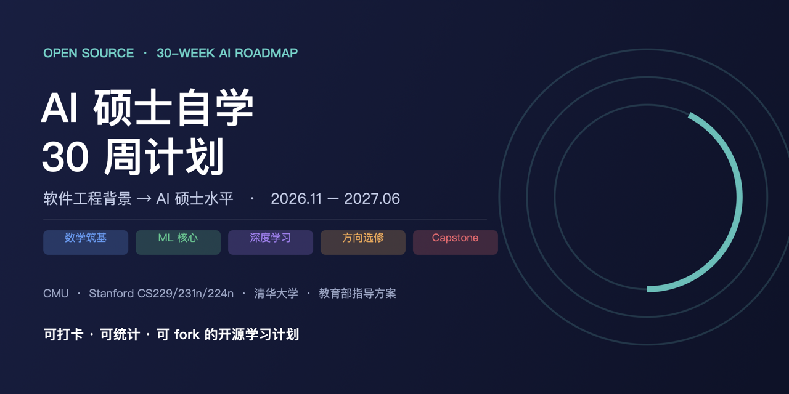
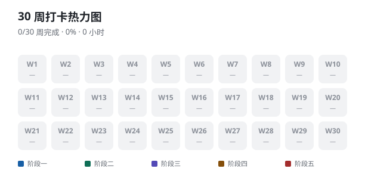

# AI 硕士自学 30 周计划

**软件工程背景自学 AI 的 30 周开源路线图：每周有可执行的作业、可打卡的网页和可展示的产出物。**
基于 CMU 机器学习硕士核心课、Stanford CS229/CS231n/CS224n、清华大学 CS 培养方案、
教育部《人工智能领域研究生指导性培养方案（试行）》压缩，2026.11.30 – 2027.06.30。

<!-- WEEKLY:START -->
> 📌 **当前定位**：开学准备周（11/23–11/29）—— 把项目传上 GitHub、三平台身份就位。
> 逐日任务、隐私检查和上传日流程见 **[本周行动清单](本周行动清单.md)**（由数据自动生成，每周刷新）。
<!-- WEEKLY:END -->



[](https://github.com/jax-fox-lab/ai-selfstudy-30weeks/actions/workflows/update-stats.yml)
[](https://github.com/jax-fox-lab/ai-selfstudy-30weeks/commits)
[](LICENSE)
[](scripts/)
[](CONTRIBUTING.md)

<!-- STATS:START -->
### 当前进度 · 0%

**0 / 30 周** · 累计投入约 **0 小时**

`░░░░░░░░░░░░░░░░░░░░`

📦 **产出物**：0 / 0 个已打卡周有实际产出 · [查看索引](weeks/INDEX.md)

| 阶段 | 完成 | 进度 |
|---|---:|---|
| 阶段一 数学筑基 | 0/5 | ░░░░░░░░░░ 0% |
| 阶段二 ML 核心 | 0/6 | ░░░░░░░░░░ 0% |
| 阶段三 深度学习 | 0/7 | ░░░░░░░░░░ 0% |
| 阶段四 方向选修 | 0/7 | ░░░░░░░░░░ 0% |
| 阶段五 Capstone | 0/5 | ░░░░░░░░░░ 0% |



> 数据更新于 2026-11-23 · 由 `scripts/generate_stats.py` 自动生成，请勿手改本区块。
<!-- STATS:END -->

## 为什么这个计划不一样

多数「AI 学习路线」是一张静态清单，看完就忘。这个仓库把学习做成**可运行的系统**：

| 你能拿到什么 | 具体是什么 |
|---|---|
| 📅 **30 周可执行周表** | 每周有章节、作业、产出物、验收标准——是「做完这周能交出什么」，不是「看这些视频」 |
| 📊 **自动更新的进度看板** | 网页勾选打卡 → 导出 JSON → push → Actions 自动刷新 README 统计、热力图和产出索引 |
| 📦 **真实产出沉淀** | `weeks/` 存每周 notebook + 周记，`capstone/` 存毕业项目；打卡但没产出会被点名 |
| 🖥️ **双机协作方案** | Mac + Windows 两套环境、进度合并脚本、CUDA/MPS 自适应——两台电脑通过 GitHub 同步 |

五阶段：数学筑基 → ML 核心 → 深度学习 → 方向选修 → Capstone。

## 快速开始（30 秒）

```bash
git clone https://github.com/jax-fox-lab/ai-selfstudy-30weeks.git
cd REPO
open docs/plan.html          # macOS；Windows: start docs\plan.html；Linux: xdg-open
```

打开网页 → 勾选完成的周 → 点「导出进度 JSON」→ 覆盖 `data/progress.json` → commit & push。
Actions 会在几十秒内自动更新上面的统计。想记录产出？`python3 scripts/new_week.py 13` 一键建好周目录。

**第一次上传？** 先看 [上传手册](docs/UPLOAD_GUIDE.md)——按 macOS + git 环境写了逐步操作和失败排查。
**不知道机器够不够用？** 看 [环境与算力指南](docs/SETUP.md)——含 Apple Silicon、Windows + RTX 4060 Ti 适配和免费算力方案。
**两台电脑都要用？** 看 **[双机学习与 GitHub 同步方案](docs/DUAL_MACHINE.md)**——双机分工、进度合并、冲突处理、
Windows 环境配置都在这里。核心是 `scripts/merge_progress.py`：双机导出的进度先合并再 push，避免互相覆盖。

**想把这个项目做成自媒体？** 看 [自媒体规划](docs/MEDIA_PLAN.md)——账号策略、主页观感优化、
B站 + 小红书内容流水线、30 周发布节奏。
**三个账号都没建设过？** 看 [三平台身份改造方案](docs/BRAND_SETUP.md)——昵称怎么定、旧号要不要换、
统一头像、各平台改名规则坑，附 11/24–11/29 执行顺序。

## 目录结构

```
.
├── README.md                  # 本文件，统计区块由脚本自动维护
├── 本周行动清单.md             # 由进度数据自动生成的「当前周视图」，每周刷新 ★
├── LEARNINGS.md               # 踩坑记录（最有长期价值的文件）
├── CONTRIBUTING.md            # 贡献指南
├── LICENSE                    # MIT
├── data/
│   ├── progress.json          # 唯一进度数据源（网页导出的文件放这里）
│   └── weekly_tasks.json      # 本周行动清单的任务模板（准备周 / 每周流程 / 特殊周）
├── docs/
│   ├── plan.html              # 打卡网页 + 数据视图
│   ├── progress.svg           # 自动生成的打卡热力图
│   ├── UPLOAD_GUIDE.md        # 首次上传手册
│   ├── DUAL_MACHINE.md        # 双机分工与 GitHub 同步方案 ★
│   ├── MEDIA_PLAN.md          # 自媒体规划（账号 / 主页 / 内容流水线）
│   ├── BRAND_SETUP.md         # 三平台身份改造方案（昵称 / 头像 / 改名规则）
│   ├── SETUP.md               # 环境与算力指南（Mac + Windows）
│   ├── social-preview.png     # 仓库社交预览图 1280×640
│   └── avatar.png             # 三平台统一头像 512×512（像素Q版人物 + 狐狸 + AI芯片徽章）
├── scripts/
│   ├── generate_stats.py      # 统计生成脚本，零依赖
│   ├── generate_index.py      # 生成周产出索引 INDEX.md
│   ├── generate_weekly.py     # 生成本周行动清单 + README 定位区块
│   ├── new_week.py            # 周产出目录脚手架
│   ├── merge_progress.py      # 双机进度合并（避免互相覆盖）
│   └── device_check.py        # 设备自检（cuda / mps / cpu）
├── requirements-mac.txt       # Mac 依赖清单
├── requirements-win.txt       # Windows 依赖清单（CUDA 版 torch）
├── .gitattributes             # 统一 LF 换行符，消除双机 diff 噪音
├── .github/
│   ├── workflows/
│   │   └── update-stats.yml   # push 后自动更新统计与索引
│   ├── ISSUE_TEMPLATE/        # 链接失效 / 内容建议模板
│   └── PULL_REQUEST_TEMPLATE.md
├── weeks/                     # 每周产出物（见 weeks/README.md）
│   ├── INDEX.md               # 自动生成的产出索引
│   └── wNN-主题/              # new_week.py 创建
└── capstone/                  # W26–W30 连续项目产出（见 capstone/README.md）
```

## 学习产出怎么放

**一句话：每周用脚手架建目录，产出的代码和周记一起进 git，README 自动统计。**

```bash
python3 scripts/new_week.py 13     # 建 weeks/w13-CNN-与训练技巧/，含周记模板 + notebook 骨架
```

- 目录命名、主题、阶段全部自动生成，不用手工拼路径
- 写周记（尤其「踩的坑」）——这部分以后最值钱，会汇总进 `LEARNINGS.md`
- 结果图放 `output/`，模型权重和数据集**不进 git**（已配置 gitignore）
- push 后 Actions 自动刷新 README 的产出物统计和 [周索引](weeks/INDEX.md)

详细规范见 [weeks/README.md](weeks/README.md)。W26–W30 的 Capstone 是连续项目，
产出放 [`capstone/`](capstone/README.md)，不按周拆。

## 怎么更新进度

三种方式，任选其一：

**方式一 · 网页导出（推荐）**
1. 打开 `docs/plan.html`，勾选完成的周
2. 点「导出进度 JSON」，得到 `progress.json`
3. 覆盖 `data/progress.json`，提交：`git commit -am "progress: W12 done"`
4. push 后自动更新

**方式二 · 直接编辑 JSON**
编辑 `data/progress.json` 里对应周的 `done` 和 `completed_at`，提交即可。

**方式三 · 复制到 GitHub 网页编辑器**
点网页里的「复制 Markdown 摘要」，粘贴到 GitHub Issue 里做周记，进度 JSON 仍按方式一更新。

### 双机用户注意（Mac + Windows）

两台机器各自打卡后，**不要直接覆盖 `data/progress.json`**，否则后 push 的会抹掉先 push 的进度。
正确做法是先合并：

```bash
# 把本机导出的进度合并进仓库版本（done 取 OR、日期取最早、工时取最大）
python3 scripts/merge_progress.py data/progress.json ~/Downloads/progress.json -o data/progress.json
git commit -am "progress: merge mac+win" && git push
```

切换机器前先 `git pull --rebase`。完整流程见 [DUAL_MACHINE.md](docs/DUAL_MACHINE.md)。

## 本地生成统计

```bash
python3 scripts/generate_stats.py          # 生成 README 区块 + docs/progress.svg
python3 scripts/generate_stats.py --check  # CI 检查统计是否过期
python3 scripts/generate_index.py          # 生成 weeks/INDEX.md 产出索引
python3 scripts/generate_weekly.py         # 刷新本周行动清单 + README 定位区块
python3 scripts/generate_weekly.py --week 13 --print  # 预览第 13 周任务
python3 scripts/new_week.py --all          # 查看 30 周主题清单
```

不需要 `pip install`，只用 Python 标准库。

## 课程来源

| 来源 | 用在哪 |
|---|---|
| [CMU ML 硕士课程](https://ml.cmu.edu/academics/machine-learning-masters-curriculum) | 6 门核心课骨架：ML、DL、PGM、优化、概率统计、实践 |
| [Stanford CS229](https://cs229.stanford.edu/) / [CS231n](https://cs231n.stanford.edu/) / [CS224n](https://web.stanford.edu/class/cs224n/) | 阶段二、三的具体教材与作业 |
| [清华大学 CS 硕士培养方案](https://www.cs.tsinghua.edu.cn/__local/6/2B/74/43E402B80F178897CFE6FCED2AD_09F6E122_6157F.pdf) | 高级机器学习、深度学习、NLP 课程群 |
| [教育部指导性培养方案](https://www.peopleapp.com/rmharticle/30029634192) | 数学优化、AI 模型与理论、CV/NLP 的必备性依据 |
| [上交电院 AI 培养](https://www.jiemian.com/article/3128904.html) / [哈工大 AI 体系](https://www.sgpjbg.com/searchtag/26732389.html) | 数学权重与课程结构 |

所有外链于 2026-11-23 实测；Hugging Face 直连国内 502 的资源统一替换为 [hf-mirror.com](https://hf-mirror.com/)。

## 开源友好

欢迎 fork、改进课程表、补充中文资源、提 issue 纠正失效链接。详见 [CONTRIBUTING.md](CONTRIBUTING.md)。

## License

[MIT](LICENSE) · 课程资源版权归各原作者所有，本仓库只做整理与排期。
